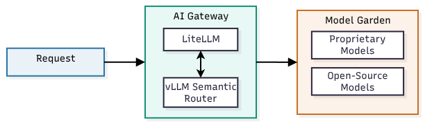
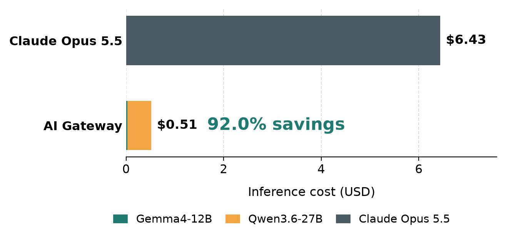
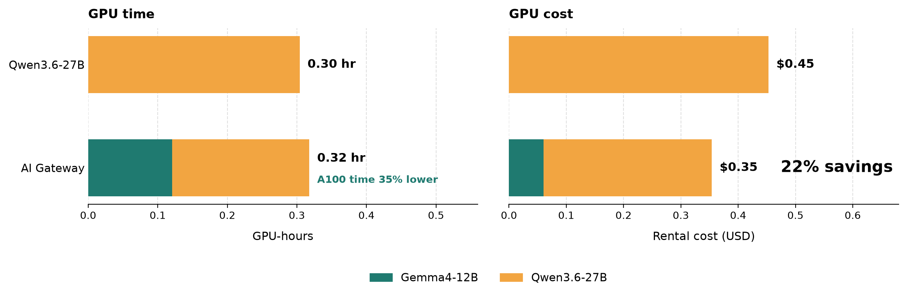

# cs5903-ai-gateway

# AI Gateway: LiteLLM + vLLM Semantic Router

CS5903 final project | Project 17 | Group 40 | Mohana Bathula

Cut inference cost by sending easy requests to a small model and harder ones to a large model. LiteLLM handles access (keys, limits, spend). The vLLM Semantic Router chooses the model.

- Final report: `docs/Project_Report.pdf`
- Architecture decisions: `docs/Architecture_Decision_Records.md`
- Final tag: `cs5903-final-2026` (commit SHA: 59dd8af424e498389eaf7a5a4f77a0b7b5ec40ea)

## 1. Status

| Part | State |
|---|---|
| Client -> LiteLLM -> router -> gemma (easy cases) | Works end to end |
| Client -> LiteLLM -> router -> Qwen (hard cases) | Works end to end, with the small proxy in `demo/qwen_shim.py` running in front of Qwen (see section 7). Without the proxy, requests routed to Qwen fail with a 502. |
| Easy vs rest classification | Works. 97% of 300 test cases reached the intended model |
| Medium vs hard classification | Does not work. The router gives both the same scores |
| Answer quality (gemma only, Qwen only, routed) | Not run |

The 97% is optimistic: the cut-offs were chosen from results on the same 300 test cases. A clean evaluation is not done. Cost figures in the report are theoretical estimates, not measured spend (no Claude API key was available; the models run on our own GPUs).

## 2. Architecture



*The diagram shows the general design. In the tested system the model garden contained only gemma-12b and Qwen3.6-27B; no proprietary model was called.*

How the router decides: it embeds the prompt (mmBERT, CPU) and compares it with 40 easy and 40 hard example prompts in the config. Margin = hard score minus easy score. Margin at or below -0.01 is easy, above 0.027 is hard, in between is medium. Decisions, highest priority first: `hard-route` (200) and `medium-route` (175) go to Qwen3.6-27B, `easy-route` (150) and `default-route` (100) go to gemma-12b. There is no training step.

## 3. Prerequisites

- A Linux server with Docker and Docker Compose (we used the host `netx3`)
- Python 3 and `jq`
- Router CLI `vllm-sr` 0.4.0 in a virtualenv (config version v0.3). Install command: [CONFIRM: how it was installed into `~/vllm-sr-env`]
- Two running vLLM backends:
  - Qwen3.6-27B on 1x A100 80GB (GPU node `slurm-comp01`, port 9000, 200k context)
  - gemma served as `gemma4-12b` on 1x RTX PRO 4000 24GB at `10.68.0.47:8000` (131k context)
- SSH access to the GPU node (host alias `slurm-gw`), for the Qwen tunnel
- The benchmark dataset (health-insurance claims, 1,000 cases). **It is not in this repo.** Obtain `dataset.zip` from the course source and place it in the repo root. It is git-ignored.

Pinned versions we used: vllm-sr 0.4.0; LiteLLM image `ghcr.io/berriai/litellm:main-stable` (digest: [FILL IN, from `docker compose images`]); Postgres 16; vLLM 0.28.0 on the backends. More detail in `evaluation/environment.md` [FILL IN: create this file].

## 4. Setup

### 4.1 Get the code and configure

```bash
git clone https://github.com/mohanabathula/cs5903-ai-gateway.git
cd cs5903-ai-gateway
cp .env.example .env     # then edit .env; never commit it
```

Environment variables (see `.env.example`; values are placeholders):

| Variable | Purpose |
|---|---|
| `LITELLM_MASTER_KEY` | Admin key for LiteLLM. Keep it secret. |
| `UI_USERNAME`, `UI_PASSWORD` | Login for the LiteLLM UI at `/ui`. Use a strong password. |
| `DEMO_KEY` | Key the client scripts send. Set in your shell, not in a file. |

### 4.2 Start the Qwen tunnel (and the proxy)

Qwen runs on the GPU node and is reached through SSH. The router's config expects it at `172.17.0.1:9000` (the Docker bridge address).

Option A: with the proxy (needed to avoid the 502):

```bash
# tunnel to a local port the proxy will use
ssh -fN -o ExitOnForwardFailure=yes -o ServerAliveInterval=30 -o ServerAliveCountMax=3 \
  -L 127.0.0.1:9100:slurm-comp01:9000 slurm-gw
# proxy listens on 172.17.0.1:9000 and strips Qwen's "metrics" field
nohup python3 demo/qwen_shim.py > shim.log 2>&1 &
curl -s -m 5 http://172.17.0.1:9000/v1/models | head -c 100    # should list Qwen3.6-27B
```

Option B: direct, without the proxy (Qwen requests will return 502 through the router):

```bash
ssh -fN -o ExitOnForwardFailure=yes -L 172.17.0.1:9000:slurm-comp01:9000 slurm-gw
```

Use one option at a time, because both use port 9000.

### 4.3 Set up and start the vLLM Semantic Router

```bash
source ~/vllm-sr-env/bin/activate
export VLLM_SR_PORT_OFFSET=100          # needed for EVERY vllm-sr command
vllm-sr config validate --config config/config_medium.yaml
vllm-sr serve --config config/config_medium.yaml --minimal
```

Notes:
- `config/config_medium.yaml` is the config in use. It defines the two models, the 80 example prompts, the cut-offs (`easy_below: -0.01`, `hard_above: 0.027`) and the four decisions.
- Start-up takes about 6 minutes, because the router embeds the example prompts on CPU.
- The port offset moves the routed listener from 8899 to **8999**, because a host Redis already uses port 6379. The offset must also be set for `vllm-sr stop` and `status`.
- `--minimal` runs without the dashboard.
- Useful commands (all need the venv and the offset):

```bash
vllm-sr status
vllm-sr logs router | tail
vllm-sr route preview --json --prompt '...'      # shows decision, model and scores without calling any model
vllm-sr config schema --surface signal:complexity
```

### 4.4 Set up and start LiteLLM

LiteLLM runs from Docker Compose (`config/docker-compose.yml`: LiteLLM image plus Postgres 16, port 4000). Its config, `config/litellm_config.yaml`, defines one model, `auto`, that points at the router:

```yaml
model_list:
  - model_name: auto
    litellm_params:
      model: openai/vllm-sr/auto
      api_base: http://host.docker.internal:8999/v1
      api_key: dummy
```

Start it from the folder that holds the compose file, `litellm_config.yaml` and `.env`:

```bash
docker compose up -d
docker compose ps
curl -s http://localhost:4000/health/liveliness
```

[CONFIRM: the compose file maps `host.docker.internal` to the host, e.g. with `extra_hosts`; and the paths to the config and `.env` match your layout.]

The router needs no key. LiteLLM does: any request without a valid key gets a 401.

Create a per-user key (instead of using the master key in demos):

```bash
set -a; source .env; set +a
curl -s -X POST http://localhost:4000/key/generate \
  -H "Authorization: Bearer $LITELLM_MASTER_KEY" -H "Content-Type: application/json" \
  -d '{"key_alias":"demo","models":["auto"],"rpm_limit":10,"duration":"1d"}'
```

Other fields: `user_id`, `tpm_limit`, `max_parallel_requests`. Budgets (`max_budget`) only work if the model has a price, and `auto` has none, so add `input_cost_per_token` and `output_cost_per_token` to the model, or use rate limits instead. The admin UI is at `http://localhost:4000/ui`.

## 5. What to run

### 5.1 Check the whole path (smoke test)

```bash
export DEMO_KEY=sk-...        # your generated key
cd tests
../demo/send.sh request1      # easy claim -> gemma
../demo/send.sh request2      # hard claim -> Qwen (needs the proxy, section 4.2 Option A)
```

`send.sh` prints the first part of the prompt, the router log lines (scores and decision) and the response. `request1_claim.json` and `request2_claim.json` are request bodies built from test-split cases (`request2` was picked for a large margin, so it is a clear case, not a typical one).

Expected output:

| Request | Router log | Response |
|---|---|---|
| `request1` (easy) | `signal` at or below -0.01 (we saw -0.0142), `easy-route`, `gemma-12b` | A settlement analysis from gemma, cut at 300 tokens (`finish_reason: length` is normal) |
| `request2` (hard) | `hard_score=0.943, easy_score=0.840, signal=0.103`, `hard-route`, `Qwen3.6-27B` | With the proxy: a Qwen reply. Qwen thinks first, so raise `max_tokens` (we used 2,500) or the reply may have no content. Without the proxy: 502 |

### 5.2 Reproduce the routing-accuracy results

The experiment calls `route preview` only. No model is called.

```bash
source ~/vllm-sr-env/bin/activate
export VLLM_SR_PORT_OFFSET=100
python evaluation/routing_accuracy.py dataset.zip --split-file evaluation/split.json \
  --subset test --per-tier 100 --max-chars 2000 > ra.log 2>&1 &
python evaluation/routing_accuracy.py --from-csv evaluation/results/routing_accuracy.csv
```

- `split.json`: stratified split, 698 calibration and 302 test cases.
- Prompt per case: claim form, discharge summary, hospital bill and policy certificate (cut to 2,000 characters), after the line "Settle this health insurance claim from the documents below."
- Text is extracted with pypdf. Examples and evaluation must use the same extractor.
- The CSV is written row by row, so an interrupted run keeps its results. Count finished cases with a CSV reader, not `wc -l`, because prompts span many lines.
- To rebuild the router examples from calibration cases: `evaluation/build_examples.py` (options `--k`, `--max-chars`, `--hardtiers`).

Expected result (300 test cases, final configuration):

| Gold \ router label | Easy | Medium | Hard |
|---|---|---|---|
| Easy (100) | 96 | 4 | 0 |
| Medium (100) | 6 | 59 | 35 |
| Hard (100) | 0 | 58 | 42 |

Policy routing accuracy 97% (easy to gemma, medium and hard to Qwen), 6 of 200 missed (3%), 4 of 100 wasted (4%), 34% of traffic to gemma. Three-class accuracy 66% (197 of 300). Earlier runs are in `evaluation/results/`:

| Setup | Hard-vs-easy AUC | Policy accuracy |
|---|---|---|
| Generic example prompts | 0.497 | about 66% |
| 40 real examples, single cut-off 0.049 | 1.000 | 47% |
| 40 real examples, bands -0.01 / 0.027 | 1.000 | 97% |

### 5.3 Stop and reset

```bash
docker compose down                          # LiteLLM and Postgres
source ~/vllm-sr-env/bin/activate; export VLLM_SR_PORT_OFFSET=100
vllm-sr stop                                 # router stack
pkill -f qwen_shim.py                        # proxy
pkill -f "slurm-comp01:9000"                 # tunnel
```

## 6. Repository layout

```
config/       config_medium.yaml (router), litellm_config.yaml, docker-compose.yml
evaluation/   routing_accuracy.py, build_examples.py, split.json, pick_hard.py,
              make_requests.py, results/ (raw CSVs, metrics_finding/)
tests/        request1_claim.json, request2_claim.json (request bodies for the smoke test)
demo/         send.sh, qwen_shim.py
docs/         Project_Report.pdf, Architecture_Decision_Records.md
```

`make_config.py`, `route_test.py` and `run_claims.py` (benchmark agent harness) are not included in the final run. `run_claims.py` never ran successfully because of the Qwen 502, which was fixed after it was written. [CONFIRM: remove this paragraph if those files were added.]

## 7 Cost estimate (theoretical, not measured)




Estimated from published per-token prices and public GPU rental prices (USD 0.50 per hour for the RTX PRO 4000, USD 1.49 for the A100 80GB). Claude Opus 5.5 was never run, and the models were hosted on our own GPUs.

## 8. Licence and data

Benchmark data: health-insurance claims benchmark (1,000 synthetic cases), provided by the course. Check its terms before sharing outside the evaluators. Third-party tools: LiteLLM, vLLM Semantic Router, vLLM, Envoy, Redis, Postgres (see each project's licence).

## 11. AI assistance

Scripts, debugging and analysis in this project were developed with substantial help from Claude in a chat session. 
